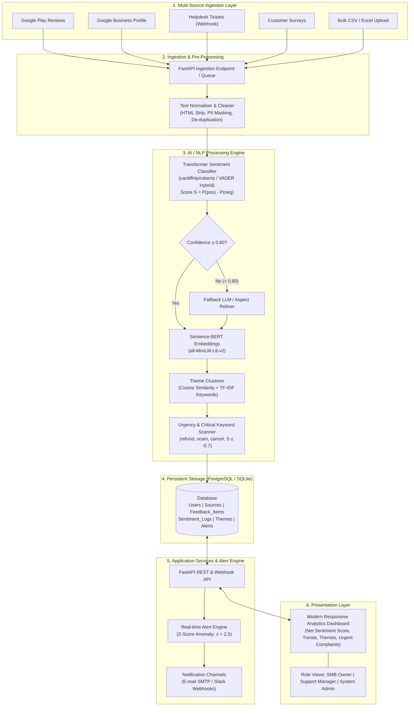
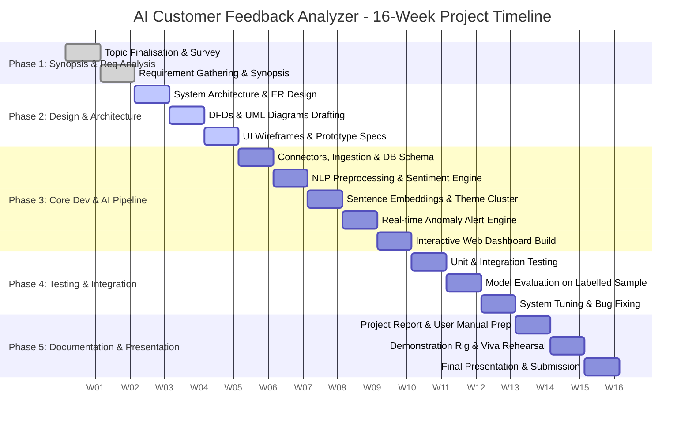
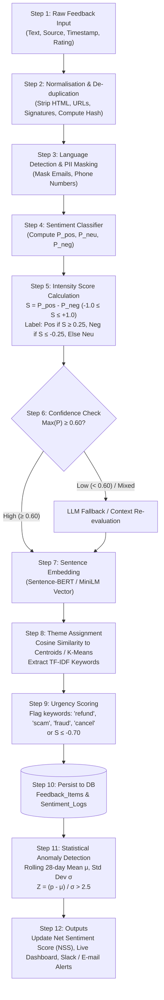
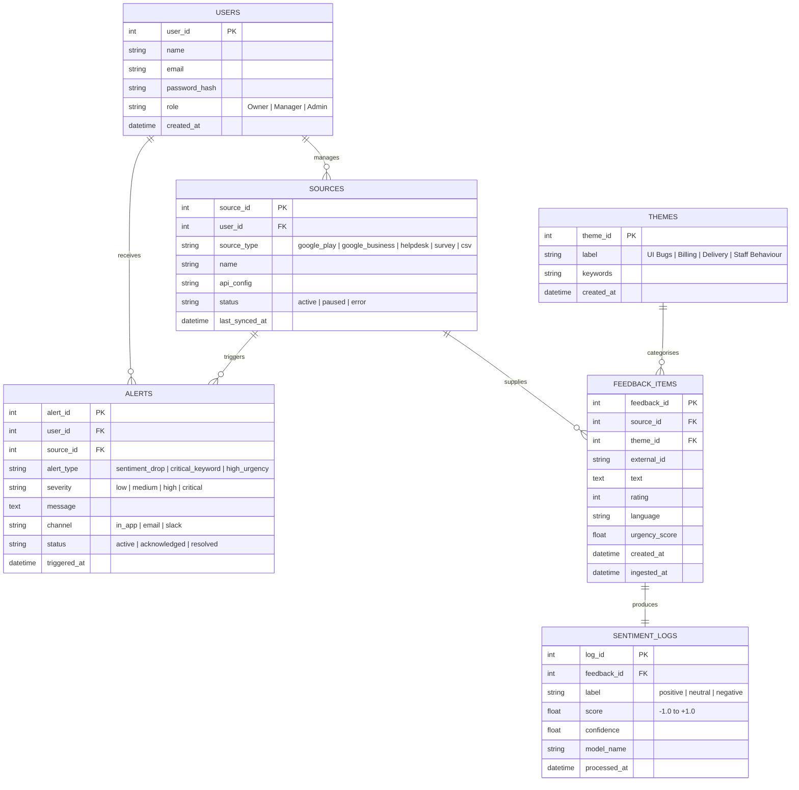
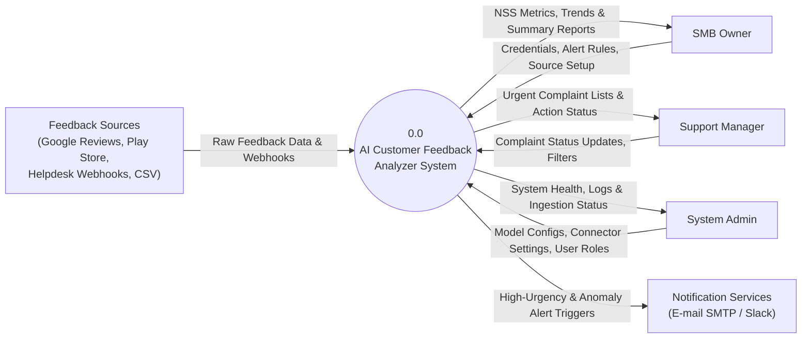
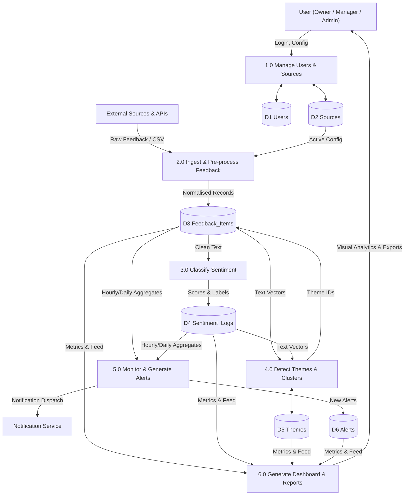
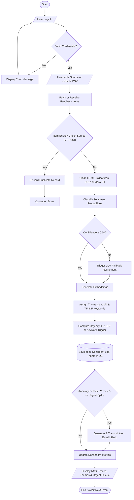
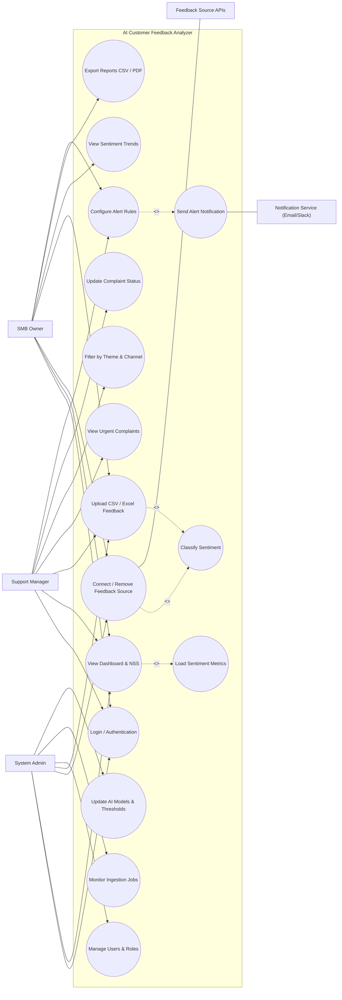
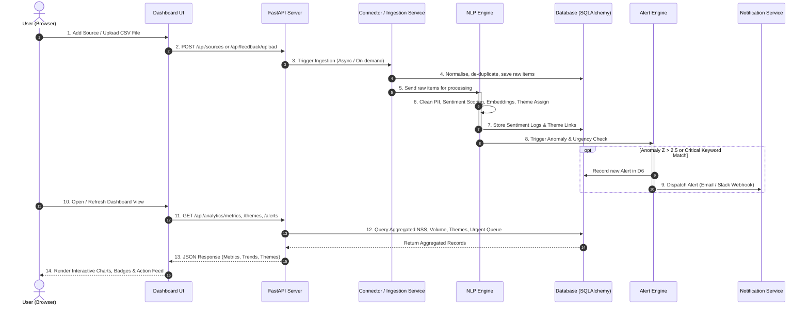

# AI Customer Feedback Analyzer - System Diagrams & Visual Architecture
**Third-Year Computer Engineering Diploma Project (MSBTE)**

This document contains complete, standards-compliant **Mermaid diagrams** for all figures (Fig. 1 to Fig. 10) specified in the project report. These can be viewed directly in markdown viewers (GitHub, VS Code Markdown Preview) and exported for project reports, presentations, and viva.

---

## Fig. 1: Overall System Architecture
Shows the end-to-end data pipeline from multi-channel ingestion, queue/pre-processing, NLP analysis workers, database storage, and the FastAPI application layer serving the dashboard and alert engine.

---

## Fig. 2: Timeline (Gantt) Diagram
16-Week Phase-Wise Schedule matching Table 3 of the project report.

---

## Fig. 3: NLP Processing Pipeline (Block Diagram)
Illustrates the exact 12-step data flow algorithm through normalisation, sentiment, clustering, urgency scoring, anomaly detection, and dashboard updates.

---

## Fig. 4: Entity Relationship (ER) Diagram
Shows the 6 relational entities, primary keys (PK), foreign keys (FK), attributes, and cardinalities according to Table 4.

---

## Fig. 5: DFD Level 0 (Context Diagram)
Depicts the entire system boundary, external entities, and high-level input/output flows.

---

## Fig. 6: DFD Level 1
Divides the system into 6 core processes and 6 persistent data stores (D1 to D6).

---

## Fig. 7: DFD Level 2 (Process 3.0 & Process 5.0)
Detailed expansion of Sentiment Classification (3.0) and Anomaly Alert Monitoring (5.0).

```mermaid
flowchart TD
    subgraph DFD_3["Process 3.0: Sentiment Classification Expansion"]
        D3_in[("D3 Feedback_Items")] --> P31["3.1 Retrieve Unprocessed Clean Text"]
        P31 --> P32["3.2 Language Detect & Tokenisation"]
        P32 --> P33["3.3 Transformer Inference / Probability Scoring"]
        P33 --> P34["3.4 Compute Intensity Score S = P_pos - P_neg"]
        P34 --> P35{"3.5 Confidence ≥ 0.60?"}
        P35 -- No --> P36["3.6 Fallback LLM / Heuristic Refiner"]
        P35 -- Yes --> P37["3.7 Assign Final Label & Confidence"]
        P36 --> P37
        P37 --> D4_out[("D4 Sentiment_Logs")]
    end

    subgraph DFD_5["Process 5.0: Anomaly Alert Engine Expansion"]
        D3_stat[("D3 Feedback_Items")] & D4_stat[("D4 Sentiment_Logs")] --> P51["5.1 Aggregate Hourly/Daily Negative Share (p)"]
        P51 --> P52["5.2 Compute Rolling 28-day Baseline (μ, σ)"]
        P52 --> P53["5.3 Calculate Z-Score: z = (p - μ) / σ"]
        P53 --> P54{"5.4 Anomaly or Critical Keyword Detected?"}
        P54 -- Yes --> P55["5.5 Cooldown & Duplicate Check"]
        P55 --> P56["5.6 Format Alert Payload & Store in D6"]
        P56 --> D6_out[("D6 Alerts")]
        P56 --> P57["5.7 Dispatch to SMTP / Slack Webhook"]
        P54 -- No --> P58["5.8 Normal Logging"]
    end
```

---

## Fig. 8: System Flowchart
Execution flow diagram corresponding to the 9 operational steps in Section 8.2.1.

---

## Fig. 9: Use Case Diagram
Visualises the role-based boundaries between SMB Owner, Support Manager, System Admin, and External Actors.

---

## Fig. 10: Sequence Diagram (Ingestion to Dashboard Render)
Illustrates message exchange across the Browser, Dashboard UI, FastAPI Server, Connector, NLP Engine, Database, Alert Engine, and Notification Services.

